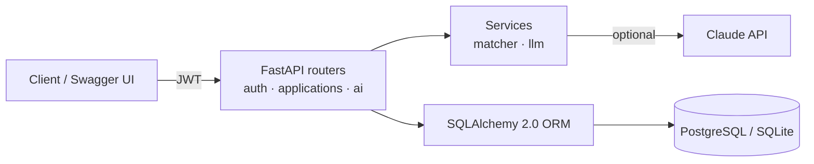

# JobPilot API

[](https://github.com/lakshmiaishwaryab/jobpilot/actions/workflows/ci.yml)


A REST API for tracking job applications and scoring your resume against a job description. It returns a 0-100 match score, the skills you have and the ones you're missing, and suggestions for improving your resume. Suggestions come from Claude when an API key is set; without a key, a rule-based engine writes them.

I built it to manage my own job search. It replaced the spreadsheet I was using.

## Features

- **JWT authentication.** Passwords are hashed with PBKDF2-SHA256, and every query is scoped to the logged-in user.
- **Application tracking.** Full CRUD with a status pipeline: `wishlist → applied → interview → offer / rejected`. You can filter, search and paginate.
- **Search analytics.** `/applications/stats` returns counts per status, response rate and average match score.
- **Follow-up reminders.** `/applications/follow-ups` lists applications with no reply after N days.
- **Resume ↔ job matching.** Skills are extracted with aliases (`k8s` → kubernetes, `postgres` → postgresql). The score combines skill coverage (75%) with a term-frequency cosine similarity (25%).
- **AI suggestions.** These come from the Claude API with JSON-parsed output. If the API fails or no key is set, rule-based suggestions are used, so the API never breaks.
- **Production setup.** Docker, docker-compose with PostgreSQL, and GitHub Actions CI (ruff lint + pytest + Docker build). Tests cover about 97% of the code.

## Architecture



```
app/
├── main.py            # app factory, router wiring
├── config.py          # 12-factor settings (env / .env)
├── database.py        # engine + session dependency
├── models.py          # User, Application, Status enum
├── schemas.py         # Pydantic request/response models
├── security.py        # password hashing, JWT
├── deps.py            # current-user dependency
├── routers/           # auth, applications, ai
└── services/
    ├── matcher.py     # skill extraction + scoring
    └── llm.py         # Claude suggestions with fallback
tests/                 # 22 pytest tests, in-memory SQLite
```

## Quick start

**With Docker (PostgreSQL):**

```bash
docker compose up --build
# open http://localhost:8000/docs
```

**Locally (SQLite):**

```bash
python -m venv .venv && source .venv/bin/activate
pip install -r requirements-dev.txt
cp .env.example .env
uvicorn app.main:app --reload
```

**Run checks:**

```bash
ruff check . && pytest --cov=app
```

## API

| Method | Endpoint | Description |
|---|---|---|
| POST | `/auth/register` | Create an account |
| POST | `/auth/login` | Get a JWT (OAuth2 password form) |
| GET | `/auth/me` | Current user |
| PUT | `/auth/me/resume` | Save resume text for matching |
| POST | `/applications` | Add an application |
| GET | `/applications?status=&q=&limit=&offset=` | List, filter, search, paginate |
| GET | `/applications/{id}` | Get one |
| PATCH | `/applications/{id}` | Partial update (e.g. move to `interview`) |
| DELETE | `/applications/{id}` | Delete |
| GET | `/applications/stats` | Pipeline counts, response rate, avg match |
| GET | `/applications/follow-ups?days=7` | Applications needing a follow-up |
| POST | `/applications/{id}/match` | Score saved resume vs this job, store score |
| POST | `/ai/match` | Score any resume vs any job description |

### Example

```bash
curl -X POST localhost:8000/ai/match -H "Authorization: Bearer $TOKEN" \
  -H "content-type: application/json" \
  -d '{"resume_text":"Python developer with FastAPI, SQL, Docker and REST APIs on Linux",
       "job_description":"Backend engineer: Python, FastAPI, PostgreSQL, Kubernetes, REST APIs"}'
```

```json
{
  "score": 57,
  "matched_skills": ["fastapi", "python", "rest apis"],
  "missing_skills": ["kubernetes", "postgresql"],
  "suggestions": ["The job asks for kubernetes, postgresql. ...", "..."],
  "suggestions_source": "rules"
}
```

## Design decisions

- **Other users' rows return 404, not 403.** This way nobody can tell whether another user's application id exists.
- **Editing a job description clears its stored match score.** A stale score is never shown.
- **The LLM is optional, and every LLM failure falls back to rules.** A third-party outage can't take the API down. The prompt tells the model never to suggest claiming skills the candidate doesn't have.
- **Password hashing uses only the Python standard library.** That avoids native-dependency problems in slim containers.
- **Tests use an in-memory SQLite database and `httpx.MockTransport` for the LLM.** They are fast and run without network access.

## Roadmap

- Alembic migrations
- Rate limiting on auth endpoints
- Resume PDF upload with text extraction
- A small React dashboard on top of the API
